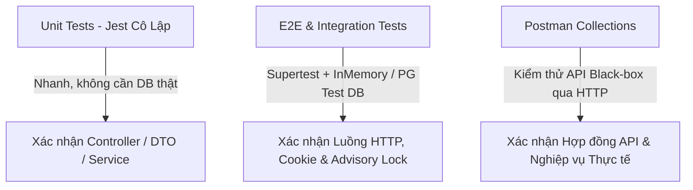

# Hướng Dẫn Kiểm Thử Từng Module (Module Testing Guide)

> **Dự án**: Nền tảng bán lại vé trực tuyến (Ticket Resell Platform)\
> **Backend Stack**: NestJS 11, TypeORM, PostgreSQL, Jest, Supertest, Postman / Newman\
> **Ngày cập nhật**: 07/10/2026\
> **Tài liệu tham khảo liên quan**: [README.md](./README.md), [api-reference.md](./api-reference.md), [local-setup.md](./postman/local-setup.md)

---

## 1. Tổng Quan Kiến Trúc & Chiến Lược Kiểm Thử

Hệ thống backend được thiết kế theo 3 tầng kiểm thử độc lập và bổ trợ lẫn nhau:



1. **Unit Tests (Cô lập)**: Sử dụng mock service, mock repository, và DTO ValidationPipe. Chạy nhanh, không phụ thuộc database, kiểm tra toàn bộ luồng rẽ nhánh logic và mã lỗi HTTP.
2. **Integration / E2E Tests**: Sử dụng `Supertest` kiểm thử luồng HTTP qua mạng ảo, xác minh cookie `HttpOnly`, xoay vòng token, và transaction locking.
3. **Black-box API Tests**: Các bộ sưu tập Postman kèm môi trường `environment` xác minh API khi server đang chạy.

---

## 2. Chuẩn Bị & Cấu Hình Môi Trường Kiểm Thử

### 2.1. Yêu cầu hệ thống
- **Node.js**: Phiên bản 20.x trở lên (đang chạy thực tế: Node.js v25).
- **PostgreSQL**: Phiên bản 15+ (khi chạy seed hoặc integration test).
- **Package Manager**: npm.

### 2.2. Lệnh kiểm tra nhanh toàn bộ
```bash
# 1. Chạy toàn bộ 20 unit test suites
npm test

# 2. Chạy E2E tests (HTTP flow)
npm run test:e2e

# 3. Kiểm tra độ bao phủ mã nguồn (Code Coverage)
npm run test:cov

# 4. Kiểm tra biên dịch TypeScript
npm run build
```

---

## 3. Hướng Dẫn Kiểm Thử Chi Tiết Từng Module

---

### 🔑 Module 1: Authentication & Authorization (`Auth Module`)

#### 1. Phạm vi & Mục tiêu
- Kiểm thử đăng ký tài khoản (`POST /api/auth/register`), mã hóa mật khẩu bcrypt, chống trùng email.
- Kiểm thử đăng nhập (`POST /api/auth/login`): trả về `accessToken` ở body, lưu `refreshToken` vào `HttpOnly` Cookie.
- Kiểm thử xoay vòng token (`POST /api/auth/refresh`) và thu hồi phiên (`POST /api/auth/logout`).
- Kiểm thử bảo vệ endpoint: `AccessTokenGuard`, `RolesGuard`, và chính sách `AccessPolicy`.

#### 2. Dữ liệu mẫu (Fixtures & Seeds)
- **Unit mock data**: [src/modules/auth/test/auth.mock-data.ts](../src/modules/auth/test/auth.mock-data.ts)
- **SQL seed**: [docs/seeds/mock-users.seed.sql](./seeds/mock-users.seed.sql)
- **Đặc tả test cases**: [docs/test-cases/auth-module-test-specification.md](./test-cases/auth-module-test-specification.md)

#### 3. Lệnh chạy kiểm thử tự động
```bash
# Chạy Unit Test Controller & Service Auth
npx jest src/modules/auth/auth.controller.spec.ts
npx jest src/modules/auth/auth.service.spec.ts
npx jest src/modules/auth/dto/auth.dto.spec.ts

# Chạy Test Token & Phân quyền RBAC
npx jest src/modules/auth/jwt/token.service.spec.ts
npx jest src/modules/auth/authorization/authorization.spec.ts

# Chạy E2E kiểm tra toàn bộ luồng Auth & Cookie jar
npx jest test/app.e2e-spec.ts -t "Auth"
```

#### 4. Kịch bản kiểm thử Postman
Sử dụng file collection: [docs/postman/login.postman_collection.json](./postman/login.postman_collection.json)
1. Gửi request `POST /api/auth/login` với tài khoản `user.buyer@ticketplatform.test` / `Password123@`.
2. Kiểm tra tab **Cookies**: Cookie `refresh_token` phải có cờ `HttpOnly`, đường dẫn `/api/auth`.
3. Kiểm tra tab **Body**: Trả về `accessToken`, tuyệt đối không có `refreshToken` trong JSON body.
4. Gửi `POST /api/auth/refresh`: Phải nhận access token mới và cookie `refresh_token` được cập nhật mới.
5. Gửi `POST /api/auth/logout`: Kiểm tra cookie `refresh_token` bị xóa (max-age=0 hoặc expires trong quá khứ).

---

### 👤 Module 2: Quản Lý Người Dùng (`Users Module`)

#### 1. Phạm vi & Mục tiêu
- Xem và cập nhật hồ sơ cá nhân (`GET /api/users/me`, `PATCH /api/users/me`).
- Đổi mật khẩu an toàn (`PATCH /api/users/me/password`): kiểm tra mật khẩu hiện tại, chống đặt trùng mật khẩu cũ, xoay vòng `tokenVersion` làm vô hiệu hóa các token cũ trên thiết bị khác.
- Phân quyền Quản trị viên (`GET /api/users`, `POST /api/users`, `PATCH /api/users/:id`): Chặn người dùng thường và kiểm duyệt viên.
- Bảo mật dữ liệu: Không bao giờ trả về mật khẩu, hash, hoặc trường nội bộ.

#### 2. Dữ liệu mẫu
- **Unit mock data**: [src/modules/users/test/users.mock-data.ts](../src/modules/users/test/users.mock-data.ts)
- **SQL seed**: [docs/seeds/mock-users.seed.sql](./seeds/mock-users.seed.sql)
- **Đặc tả test cases**: [docs/test-cases/user-module-test-specification.md](./test-cases/user-module-test-specification.md)

#### 3. Lệnh chạy kiểm thử tự động
```bash
# Chạy toàn bộ test của module Users
npx jest src/modules/users/users.service.spec.ts
npx jest src/modules/users/users.controller.spec.ts
npx jest src/modules/users/dto/users.dto.spec.ts
```

#### 4. Checklist kiểm thử thủ công
| Bước | Hành động | Kết quả mong đợi |
| :--- | :--- | :--- |
| 1 | `GET /api/users/me` với user đăng nhập | Trả về thông tin chính chủ, mã HTTP 200 |
| 2 | `PATCH /api/users/me` với `fullName: "Tên Mới"` | Cập nhật thành công |
| 3 | `PATCH /api/users/me/password` với mật khẩu sai | Báo lỗi 400 Bad Request, mật khẩu cũ giữ nguyên |
| 4 | `PATCH /api/users/me/password` đổi thành công | Thu hồi toàn bộ phiên, token cũ bị 401 khi gọi lại `/me` |
| 5 | Dùng tài khoản `USER` gọi `GET /api/users` | Báo lỗi 403 Forbidden |

---

### 🎪 Module 3: Quản Lý Sự Kiện & Thể Loại (`Events Module`)

#### 1. Phạm vi & Mục tiêu
- Thể loại sự kiện: Public danh sách thể loại đang hoạt động (`GET /api/event-categories`).
- Tạo sự kiện (`POST /api/events`): Yêu cầu quyền `ADMIN`/`MODERATOR`, đính kèm 1 file ảnh banner, `endTime > startTime`, sự kiện `published` phải bắt đầu ở tương lai.
- Cơ chế Ghim sự kiện (`PATCH /api/events/:id/pin`): Giới hạn tối đa 4 sự kiện ghim đồng thời, chỉ ghim sự kiện đã phát hành và chưa kết thúc, dùng advisory lock bảo vệ transaction.
- Dọn dẹp file: Xóa file banner trên ổ đĩa nếu database rollback hoặc khi cập nhật thay thế banner mới.

#### 2. Dữ liệu mẫu
- **Unit mock data**: [src/modules/events/test/events.mock-data.ts](../src/modules/events/test/events.mock-data.ts)
- **SQL seed**: [docs/seeds/event-categories.seed.sql](./seeds/event-categories.seed.sql) và [docs/seeds/mock-events.seed.sql](./seeds/mock-events.seed.sql)
- **Đặc tả test cases**: [docs/test-cases/events-module-test-specification.md](./test-cases/events-module-test-specification.md)

#### 3. Lệnh chạy kiểm thử tự động
```bash
# Chạy Unit Test module Events
npx jest src/modules/events/events.service.spec.ts
npx jest src/modules/events/events.controller.spec.ts
npx jest src/modules/events/dto/events.dto.spec.ts
```

#### 4. Kịch bản kiểm thử Postman
Sử dụng các collection:
- [docs/postman/events.postman_collection.json](./postman/events.postman_collection.json)
- [docs/postman/events-crud.postman_collection.json](./postman/events-crud.postman_collection.json)

1. Đăng nhập bằng tài khoản Admin để lấy token.
2. Tạo sự kiện mới với form-data (kèm file `banner` định dạng JPG/PNG).
3. Gọi `GET /api/events/pinned`: Xác nhận danh sách ban đầu.
4. Gọi `PATCH /api/events/:id/pin` với `{"isPinned": true}`.
5. Cố gắng ghim đến sự kiện thứ 5: API phải trả về `409 Conflict: At most four active events can be pinned`.

---

### 🎟️ Module 4: Quản Lý & Kiểm Duyệt Vé (`Tickets Module`)

#### 1. Phạm vi & Mục tiêu
- Đăng bán vé (`POST /api/tickets`): Chỉ đăng cho sự kiện đã phát hành và chưa kết thúc; đính kèm file vé PDF/ảnh; trạng thái khởi tạo là `pending_review`.
- Tự động hóa kiểm tra vé: Quét mã QR/Barcode local, kiểm tra trùng fingerprint, chống gian lận.
- Kiểm duyệt vé (`PATCH /api/tickets/:id/review`):
  - Quyền `ADMIN` / `MODERATOR`.
  - Nghiêm cấm người bán tự duyệt vé do chính mình đăng (`ForbiddenException`).
  - Duyệt chấp thuận (`approve`) hoặc từ chối kèm lý do (`reject`).
- Hủy đăng bán (`DELETE /api/tickets/:id`): Chỉ chủ sở hữu được hủy; chỉ cho phép hủy khi vé đang `available`, `pending_review`, `rejected`; **không cho phép hủy vé đã bán (`sold`)**.

#### 2. Dữ liệu mẫu
- **Unit mock data**: [src/modules/tickets/test/tickets.mock-data.ts](../src/modules/tickets/test/tickets.mock-data.ts)
- **SQL seed**: [docs/seeds/mock-tickets.seed.sql](./seeds/mock-tickets.seed.sql)
- **Đặc tả test cases**: [docs/test-cases/tickets-module-test-specification.md](./test-cases/tickets-module-test-specification.md)

#### 3. Lệnh chạy kiểm thử tự động
```bash
# Chạy Unit Test Controller & Service Tickets
npx jest src/modules/tickets/tickets.controller.spec.ts
npx jest src/modules/tickets/tickets.service.spec.ts
npx jest src/modules/tickets/dto/tickets.dto.spec.ts

# Chạy Test dịch vụ Kiểm duyệt vé (Review Subsystem)
npx jest src/modules/tickets/review/ticket-review.service.spec.ts
```

#### 4. Kịch bản kiểm thử Postman
Sử dụng collection: [docs/postman/tickets.postman_collection.json](./postman/tickets.postman_collection.json)
1. **User A đăng bán vé**: Upload file PDF vé, status vé là `pending_review`.
2. **User A tự gọi API duyệt vé**: Gửi `PATCH /api/tickets/:id/review` -> Nhận lỗi `403 Forbidden` (kể cả User A có quyền Admin cũng bị chặn tự duyệt vé mình).
3. **Admin B duyệt vé**: Chấp thuận vé -> Status chuyển sang `available`.
4. **Kiểm tra công khai**: Gọi `GET /api/tickets` (public) -> Vé xuất hiện trong kết quả tìm kiếm.
5. **Hủy vé**: User A gọi `DELETE /api/tickets/:id` -> Status chuyển sang `cancelled`, vé biến mất khỏi danh sách công khai.

---

### 🛒 Module 5: Đặt Hàng, Thanh Toán & Tranh Chấp (`Orders Module`)

#### 1. Phạm vi & Mục tiêu
- Tạo đơn hàng (`POST /api/orders`):
  - Chống double-charge bằng header `Idempotency-Key` (8-80 ký tự).
  - Khóa bi quan (`Pessimistic Write Lock`): Ngăn chặn 2 người cùng đặt mua 1 chiếc vé duy nhất.
  - Chặn người bán tự mua vé của chính mình.
  - Thời hạn giữ đơn thanh toán 15 phút (`expiresAt`).
- Thanh toán giả lập (`POST /api/orders/me/:id/payment/mock-result`): Thành công chuyển đơn sang `paid`, tự động bàn giao file vé (`delivered`).
- Tải file vé an toàn (`GET /api/orders/me/:id/file`): Thiết lập header `no-store`, `attachment`, `nosniff`.
- Mở khiếu nại/tranh chấp (`POST /api/orders/me/:id/dispute`): Trong cửa sổ thời hạn `disputeUntil`, người bán phản hồi, Admin/Mod giải quyết hoàn tiền hoặc thanh toán cho người bán.

#### 2. Dữ liệu mẫu
- **Unit mock data**: [src/modules/orders/test/orders.mock-data.ts](../src/modules/orders/test/orders.mock-data.ts)
- **SQL seed**: [docs/seeds/mock-orders.seed.sql](./seeds/mock-orders.seed.sql)
- **Đặc tả test cases**: [docs/test-cases/orders-module-test-specification.md](./test-cases/orders-module-test-specification.md)

#### 3. Lệnh chạy kiểm thử tự động
```bash
# 1. Chạy Unit Test Controller, DTO, Service
npx jest src/modules/orders/orders.controller.spec.ts
npx jest src/modules/orders/orders.service.spec.ts
npx jest src/modules/orders/dto/orders.dto.spec.ts

# 2. Chạy Integration Test với PostgreSQL thật (kiểm tra Concurrency & Locks)
# Chú ý: Cần database PostgreSQL đang chạy và file .env hợp lệ
$env:ORDERS_PG_TEST="1"; npm test -- src/modules/orders/orders.postgres.spec.ts
```

#### 4. Kịch bản kiểm thử Postman
Sử dụng collection: [docs/postman/orders.postman_collection.json](./postman/orders.postman_collection.json)
1. Đăng nhập tài khoản người mua (`user.buyer@ticketplatform.test`).
2. Gửi `POST /api/orders` với `ticketId` và header `Idempotency-Key: test-key-12345678`.
3. Gửi lại request trên với cùng key: Server trả về đúng đơn hàng cũ (không sinh đơn trùng).
4. Khởi tạo thanh toán `POST /api/orders/me/:id/payment`.
5. Giả lập thanh toán thành công `POST /api/orders/me/:id/payment/mock-result` với `{"result": "success"}`.
6. Tải file vé qua `GET /api/orders/me/:id/file`.
7. Mở tranh chấp `POST /api/orders/me/:id/dispute` nếu vé có sự cố.

---

## 4. Xử Lý Các Vấn Đề Thường Gặp Khi Chạy Test

### 4.1. Lỗi `ExperimentalWarning: VM Modules`
- **Hiện tượng**: Xuất hiện warning khi chạy Jest trên Node.js mới.
- **Giải thích**: Jest đang chạy với cờ `--experimental-vm-modules` để tương thích các thư viện định dạng ESM. Đây là warning tiêu chuẩn, không làm ảnh hưởng đến kết quả test.

### 4.2. Lỗi `MODULE_NOT_FOUND` do chạy đồng thời `start:dev` và `nest build`
- **Hiện tượng**: Watcher báo thiếu module trong thư mục `dist/`.
- **Giải pháp**: Không chạy `npm run build` thủ công trong khi terminal `npm run start:dev` đang bật; hoặc nếu gặp phải thì khởi động lại lệnh `npm run start:dev`.

### 4.3. Test PostgreSQL Integration bị bỏ qua (`skipped`)
- **Hiện tượng**: Suite [orders.postgres.spec.ts](../src/modules/orders/orders.postgres.spec.ts) hiển thị `1 skipped`.
- **Giải thích**: Suite này cần kết nối PostgreSQL thật để kiểm tra race condition transaction; mặc định được skip để bộ test CI/Unit test chạy tức thì dưới 10 giây. Để chạy, gán biến môi trường `ORDERS_PG_TEST=1`.
