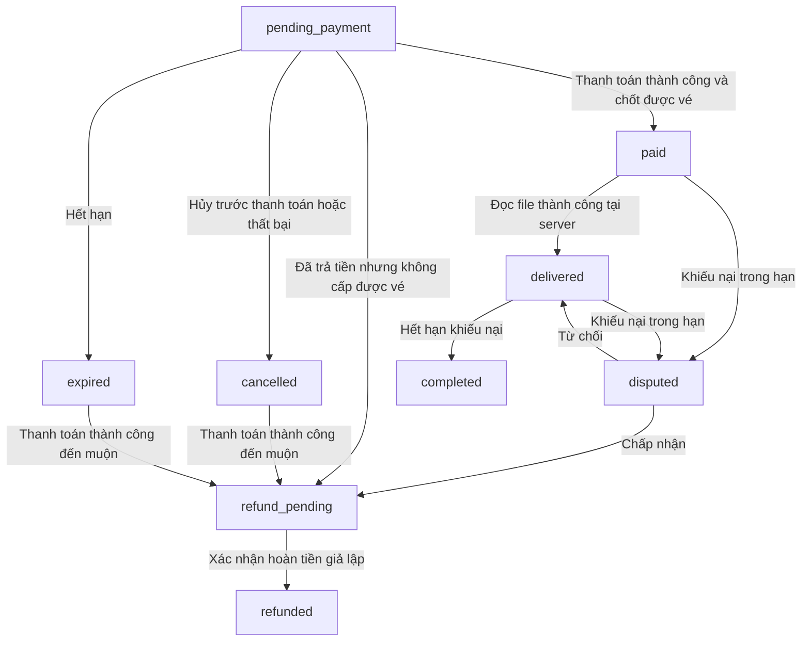

# Orders và thanh toán giả lập

Cập nhật 07/10/2026. Base URL ví dụ: `http://localhost:7000/api`.
Mọi endpoint yêu cầu Bearer access token và tài khoản active.

## Phạm vi và quy tắc

- Một đơn mua một vé. Người mua không được mua vé mình đăng.
- **Không giữ vé**: tạo đơn và bắt đầu thanh toán không đổi trạng thái vé available.
  Nhiều người có thể có đơn pending_payment cho cùng vé.
- Giá và người bán lấy từ database, người mua lấy từ principal. Đơn lưu snapshot
  tên sự kiện, hạng vé, ghế và thời gian kết thúc tại lúc đặt.
- Đơn chờ thanh toán mặc định 15 phút, tối đa tới endTime. Đây là hạn của đơn,
  không phải thời gian giữ vé. Có thể cấu hình từ 1–60 phút.
- Khi xử lý kết quả thành công, transaction chốt vé đầu tiên thắng. Vé chuyển sold,
  ghi buyerId/soldAt và đơn chuyển paid trong cùng transaction.
- Thanh toán thành công nhưng vé đã bán, sự kiện không hợp lệ, đơn đã hủy/hết hạn
  hoặc một bên không còn active: đơn và thanh toán chuyển refund_pending.
- Một payment cho một đơn. Nếu failed/cancelled, tạo đơn mới bằng key mới để thử lại.
- Tất cả thanh toán, hoàn tiền và chi trả hiện là **giả lập**, không có tiền thật.
  Chưa tích hợp VNPay và chưa có endpoint nhận webhook/IPN thật.

Người thắng là người được backend chốt trước, không cam kết là người bị trừ tiền
trước ở một cổng bên ngoài. Thông báo từ cổng có thể tới khác thứ tự.

## Vòng đời



Khi bác khiếu nại, khôi phục paid nếu chưa từng đọc file hoặc delivered nếu đã đọc;
nếu delivered và đã hết hạn khiếu nại thì chuyển completed. Sự kiện hủy khi đơn
paid/delivered cũng đưa đơn sang refund_pending. Tranh chấp đang mở chờ người quản lý
ra quyết định. Vé đã cấp không được tự đăng bán lại sau hoàn tiền: giữ sold và
dấu allocation để tránh tái bán file đã bị lộ.

`completed` chỉ có nghĩa đủ điều kiện chi trả; `payoutStatus=paid` là bước riêng.
Payout lần lượt none → pending → ready → paid; tranh chấp dùng blocked.

## API người dùng

Các đường dẫn dưới đây đã có prefix /api. Route /me chỉ cho người mua/người bán
của đơn; ADMIN/MODERATOR không vượt quyền sở hữu ở /me.

| Method | URL | Quyền | Thành công |
| --- | --- | --- | --- |
| POST | /api/orders | Mọi tài khoản active | 201; đơn vừa tạo hoặc đơn cùng key |
| GET | /api/orders/me | Người mua hoặc người bán | 200; {items,total,page,limit} |
| GET | /api/orders/me/:id | Người mua hoặc người bán | 200; chi tiết đơn, payment và dispute |
| POST | /api/orders/me/:id/cancel | Chỉ người mua | 200; đơn cancelled |
| POST | /api/orders/me/:id/payment | Chỉ người mua, mock bật | 200; đơn kèm payment |
| POST | /api/orders/me/:id/payment/mock-result | Chỉ người mua, mock bật | 200; kết quả xử lý |
| GET | /api/orders/me/:id/file | Chỉ người mua đã được cấp vé | 200; file nhị phân |
| POST | /api/orders/me/:id/dispute | Chỉ người mua | 201; đơn disputed |
| POST | /api/orders/me/:id/dispute/reply | Chỉ người bán | 200; phản hồi tranh chấp |

### Tạo đơn

```http
POST /api/orders
Authorization: Bearer <buyerAccessToken>
Idempotency-Key: checkout-unique-key-001
Content-Type: application/json

{"ticketId":"ticket_example"}
```

Header Idempotency-Key bắt buộc: 8–80 ký tự chữ, số, dấu gạch ngang hoặc gạch dưới.
Key có phạm vi theo buyer. Cùng key/cùng vé trả lại đơn cũ, không gia hạn; cùng key
nhưng vé khác trả 409. Retry sau lỗi mạng phải giữ key cũ. Không gửi amount,
buyerId, sellerId, status hoặc trường ngoài DTO.

### Danh sách

Query tùy chọn: page (mặc định 1, tối đa 100000), limit (20, tối đa 100),
side=buyer|seller, status theo trạng thái đơn. Bỏ side lấy cả hai phía.
Sắp createdAt DESC rồi order_id ASC. Không có kết quả trả items=[], total=0.
Danh sách đọc trạng thái đã lưu; worker hoặc thao tác chi tiết đối soát các đơn
hết hạn. Frontend dùng expiresAt để hiển thị đếm ngược, backend luôn kiểm tra hạn
trong transaction khi chốt thanh toán, kể cả worker đang tắt.

### Thanh toán và kết quả giả lập

Gọi POST /me/:id/payment, không cần body, để tạo payment. Gọi lặp trả payment
hiện có, không tạo payment thứ hai. Sau đó gửi:

```json
{"result":"success"}
```

result chỉ nhận success/failed/cancelled. Cùng kết quả gửi lại trả trạng thái hiện
tại; gửi kết quả khác sau khi payment đã có kết quả trả 409. Không nhận số tiền từ
client. Khi thêm VNPay phải có adapter xác minh chữ ký, mã tham chiếu, tiền tệ,
số tiền và giao dịch trước khi gọi nghiệp vụ chốt; không dùng endpoint mock làm IPN.

### Bàn giao file

Sau paid, buyer được gọi GET /me/:id/file. Server đọc file thành công lần đầu
thì ghi deliveredAt và đổi sang delivered; lỗi I/O giữ paid để thử lại. Điều này
ghi nhận server phục vụ file, không chứng minh trình duyệt tải xong hoặc vé vào
cửa thành công. paid/delivered/disputed/completed được tải; refund_pending/refunded
không được tải. Seller và người ngoài không dùng endpoint này để đọc file.
Response có MIME của file, Cache-Control: no-store, nosniff, Content-Disposition:
attachment; không có envelope JSON. Không phát URL static công khai.

## Tranh chấp và đối soát

Hạn khiếu nại là 24 giờ sau endTime của sự kiện lúc mua. Nếu sự kiện kéo dài,
hạn được kéo dài theo khi đối soát; không rút ngắn hạn đã cấp. Buyer được mở khi
paid hoặc delivered và còn hạn, kể cả chưa nhận được file. Mỗi đơn một tranh chấp.

```json
{"reason":"Vé sai hạng","evidence":"Mô tả bằng chứng và mã tham chiếu liên quan."}
```

reason trim 1–2000 ký tự, evidence trim 1–5000 ký tự. Phiên bản này lưu bằng chứng
dạng văn bản, chưa upload ảnh/video. Không tự mở URL trong nội dung. Seller gửi
`{"response":"Giải trình của người bán"}` (1–5000 ký tự), chỉ một phản hồi;
gửi lại cùng nội dung được chấp nhận, không cho ghi đè lời giải trình cũ.

Đơn disputed không tự completed, không chi trả. Người quản lý không được quyết
định hoặc giả lập chuyển tiền cho đơn mà mình là buyer/seller.

| Method | URL | Quyền | Nội dung |
| --- | --- | --- | --- |
| GET | /api/orders/manage | ADMIN/MODERATOR | Danh sách mọi đơn; page/limit/status; side không áp dụng |
| GET | /api/orders/manage/:id | ADMIN/MODERATOR | Chi tiết hỗ trợ, không có file gốc |
| POST | /api/orders/manage/:id/dispute/resolve | ADMIN/MODERATOR ngoài giao dịch | accept hoặc reject, kèm note |
| POST | /api/orders/manage/:id/refund/mock | ADMIN/MODERATOR ngoài giao dịch, mock bật | Xác nhận hoàn tiền giả lập |
| POST | /api/orders/manage/:id/payout/mock | ADMIN/MODERATOR ngoài giao dịch, mock bật | Xác nhận chi trả giả lập |

Quyết định: `{"decision":"accept","note":"Kết quả đối chiếu"}`; decision là
accept/reject, note trim 1–2000 ký tự. Quyết định lưu người xử lý/thời gian/lý do,
không được ghi đè. Accept đưa sang refund_pending, chưa phải refunded. Hai API
chuyển tiền không cần body, chỉ chuyển trạng thái giả lập; gọi lại không chuyển
tiền lần nữa. Chi trả chỉ cho completed, hết hạn khiếu nại, sự kiện published và
payment succeeded. Không có API để client tự đánh dấu completed hoặc sold.

## Response JSON và lỗi

JSON dùng envelope success/statusCode/message/data/timestamp hiện có.
Chi tiết data ví dụ (ID/thời gian minh họa):

```json
{
  "order_id":"order_example",
  "ticketId":"ticket_example",
  "buyerId":"user_buyer",
  "sellerId":"user_seller",
  "amount":"800000.00",
  "currency":"VND",
  "status":"paid",
  "ticket":{"eventName":"Concert","ticketTier":"VIP","seatInfo":"A15","eventEndTime":"2026-11-20T16:00:00.000Z"},
  "expiresAt":"2026-10-07T08:15:00.000Z",
  "paidAt":"2026-10-07T08:01:00.000Z",
  "deliveredAt":null,
  "disputeUntil":"2026-11-21T16:00:00.000Z",
  "reason":null,
  "payoutStatus":"pending",
  "createdAt":"2026-10-07T08:00:00.000Z",
  "updatedAt":"2026-10-07T08:01:00.000Z",
  "payment":{"payment_id":"payment_example","provider":"mock","amount":"800000.00","currency":"VND","status":"succeeded","settledAt":"2026-10-07T08:01:00.000Z"},
  "dispute":null
}
```

Amount là chuỗi thập phân để tránh mất chính xác, khác giá number trong API Tickets.
Danh sách không kèm payment/dispute; chi tiết và thao tác ghi kèm hai trường nullable.
Không trả entity quan hệ, password, idempotencyKey, QR/hash/file hoặc token.

- 400: DTO/key không hợp lệ, tự mua vé mình.
- 401: không có token/phiên hợp lệ.
- 403: thiếu quyền quản trị hoặc tự xử lý giao dịch của mình.
- 404: không tồn tại, ngoài quyền sở hữu, file không còn hoặc mock bị tắt.
- 409: vé không còn bán được, trạng thái không cho thao tác, key/kết quả bị xung đột.

## Database, worker và chạy local

Áp dụng [orders-schema.sql](./orders-schema.sql) trước khi chạy API với
DB_SYNCHRONIZE=false. Bổ sung ba bảng orders/order_payments/order_disputes, khóa
ngoại RESTRICT và unique index: buyer+key, một payment/dispute mỗi đơn và chỉ một
đơn allocated cho mỗi vé. Không xóa dữ liệu Tickets/Users/Events.

Mọi thao tác đơn dùng thứ tự khóa Event → Ticket → Order → Payment/Dispute,
transaction READ COMMITTED. Chốt vé và ghi nhận tiền cùng transaction; lỗi sẽ rollback.
Idempotency tạo đơn dùng advisory lock buyer+key rồi unique index. Thời gian quyết
định lấy từ PostgreSQL sau khi lấy khóa; không tin thời gian từ trình duyệt.

```dotenv
PAYMENT_MOCK_ENABLED=true
ORDERS_WORKER_ENABLED=true
ORDER_PAYMENT_TIMEOUT_MINUTES=15
```

Mock mặc định false và chỉ hoạt động khi NODE_ENV là development hoặc test;
production/provision luôn từ chối dù cờ true. Worker mặc định false, chạy trong
tiến trình API, mỗi 15 giây xử lý tối đa 100 đơn theo lô; không cần Redis. Worker
khởi động lại quét đơn tồn đọng; nhiều tiến trình có thể cùng chạy nhờ khóa hàng.
Với lượng đơn lớn, độ trễ phụ thuộc số lô. Chi tiết đơn và các thao tác quan trọng
cũng đối soát trạng thái. Worker không tự giả lập hoàn tiền/chi trả.

Audit HTTP: orders.create/cancel/payment.start/payment.mock/file.read/dispute.open/
dispute.reply/dispute.resolve/refund.mock/payout.mock. Worker ghi orders.reconcile;
không log file, bằng chứng, token hoặc body thanh toán.

## Kiểm thử và giới hạn

Test PostgreSQL opt-in dùng schema ngẫu nhiên orders_test_* trên PostgreSQL local,
áp dụng SQL hai lần để kiểm tra khả năng chạy lại, rồi dọn đúng schema đã tạo:

```powershell
$env:ORDERS_PG_TEST='1'
npm test -- --runInBand src/modules/orders/orders.postgres.spec.ts
Remove-Item Env:ORDERS_PG_TEST
```

Test đọc thông tin kết nối từ .env; có thể ghi đè bằng ORDERS_TEST_DB_HOST/PORT/
USERNAME/PASSWORD/NAME. Chỉ cho host loopback và từ chối .env production. Test
không sửa bảng nghiệp vụ hiện có. Không bật biến trên khi chỉ muốn chạy unit test.

Chưa có VNPay/IPN, tiền thật, nhiều lần thanh toán trên cùng đơn, phí nền tảng,
upload bằng chứng, thông báo người dùng hoặc thống kê doanh số tự động. Hoàn tiền
không khôi phục quyền bán vé đã bàn giao. Thay đổi/hủy sự kiện sau khi đã completed
và chi trả cần quy trình hỗ trợ riêng trước triển khai thanh toán thật.
