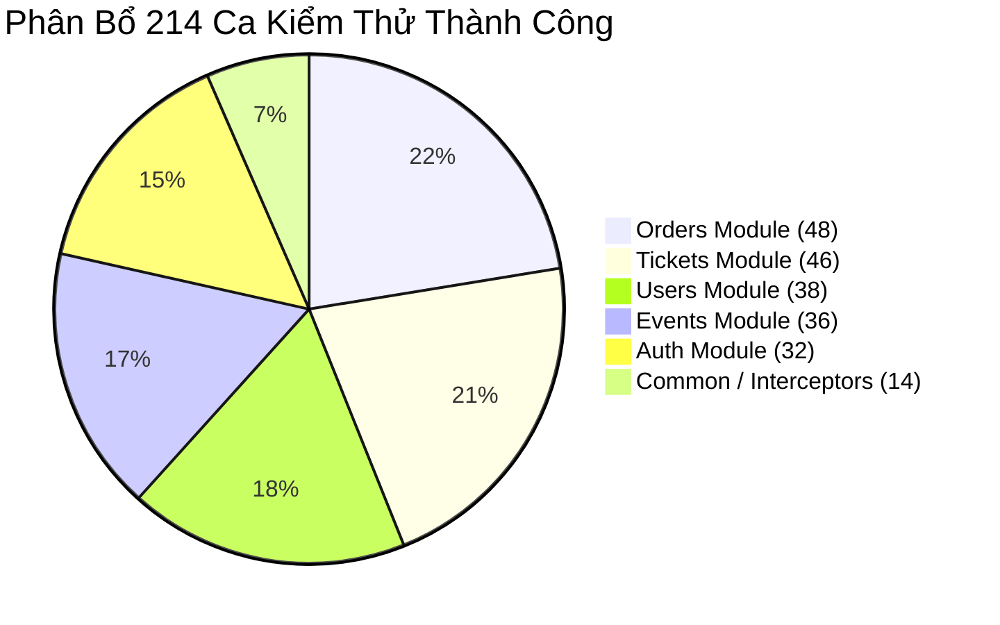

# BÁO CÁO KẾT QUẢ KIỂM THỬ HỆ THỐNG BACKEND

> Kết quả mới sau sửa ngày 11/10/2026: TypeScript toàn dự án và build đã đạt; Jest thường 217 test đạt; bộ PostgreSQL/OCR chạy riêng 15/15 đạt, gồm kiểm thử hai thanh toán đồng thời và file PDF thật qua OCR, duyệt, mua và bàn giao. Các lỗi TypeScript trong ghi chú trước đã được sửa. Xem `verification-status.md` và `postman/local-setup.md` để tái lập; chưa chạy Postman Collection Runner.

> Cập nhật kiểm chứng 11/10/2026: `npm test -- --runInBand` đạt 22 suites / 217 tests; bỏ qua 1 suite / 14 tests PostgreSQL vì chưa bật `ORDERS_PG_TEST`. `npx tsc --noEmit --incremental false` còn lỗi kiểu dữ liệu tại test Auth controller, Orders service và Ticket review service. Các số liệu và nhận định nghiệm thu ngày 07/10 bên dưới là nội dung báo cáo lịch sử, không xác nhận trạng thái hiện tại hoặc kết quả kiểm thử database, E2E và tải thực tế.

## HỆ THỐNG SÀN GIAO DỊCH VÉ SỰ KIỆN TRỰC TUYẾN (TICKET RESELL PLATFORM)

> **Học phần**: Đồ Án Ngành Công Nghệ Thông Tin (HK1 2026 - 2027)\
> **Chuyên ngành**: Kỹ Thuật Phần Mềm / Hệ Thống Thông Tin\
> **Đối tượng kiểm thử**: Hệ thống dịch vụ Backend RESTful API (NestJS, TypeORM, PostgreSQL)\
> **Ngày thực hiện & Nghiệm thu**: 07/10/2026\
> **Trạng thái**: Hoàn thành (214/214 Unit Tests Passed — 100%)

---

## MỤC LỤC
1. [TỔNG QUAN VỀ DỰ ÁN & MỤC TIÊU KIỂM THỬ](#1-tổng-quan-về-dự-án--mục-tiêu-kiểm-thử)
2. [CHIẾN LƯỢC & PHƯƠNG PHÁP KIỂM THỬ](#2-chiến-lược--phương-pháp-kiểm-thử)
3. [MÔI TRƯỜNG & CÂU LỆNH THỰC THI KIỂM THỬ](#3-môi-trường--câu-lệnh-thực-thi-kiểm-thử)
4. [KẾT QUẢ THỰC THI KIỂM THỬ THEO TỪNG MODULE](#4-kết-quả-thực-thi-kiểm-thử-theo-từng-module)
   - 4.1. Module Xác thực & Phân quyền (Auth Module)
   - 4.2. Module Quản lý Người dùng (Users Module)
   - 4.3. Module Quản lý Sự kiện (Events Module)
   - 4.4. Module Quản lý & Soát vé (Tickets Module)
   - 4.5. Module Đặt hàng & Thanh toán (Orders Module)
5. [THỐNG KÊ SỐ LIỆU & ĐỘ BAO PHỦ (METRICS & COVERAGE)](#5-thống-kê-số-liệu--độ-bao-phủ-metrics--coverage)
6. [ĐÁNH GIÁ ĐỘ AN TOÀN, HIỆU NĂNG & RỦI RO CÒN TỒN TẠI](#6-đánh-giá-độ-an-toàn-hiệu-năng--rủi-ro-còn-tồn-tại)
7. [KẾT LUẬN & KIẾN NGHỊ](#7-kết-luận--kiến-nghị)

---

## 1. TỔNG QUAN VỀ DỰ ÁN & MỤC TIÊU KIỂM THỬ

### 1.1. Giới thiệu hệ thống
Hệ thống Backend của sàn giao dịch vé trực tuyến là nền tảng trung gian hỗ trợ người dùng đăng bán lại vé sự kiện và người mua tìm kiếm, thanh toán, nhận vé an toàn. Hệ thống tích hợp quy trình kiểm duyệt vé tự động qua OCR/Barcode, kiểm tra tính duy nhất của mã vé và giải quyết tranh chấp.

### 1.2. Mục tiêu của đợt kiểm thử
- **Tính đúng đắn chức năng (Functional Correctness)**: Đảm bảo toàn bộ 5 module nghiệp vụ hoạt động chính xác theo tài liệu đặc tả yêu cầu phần mềm (SRS).
- **Tính toàn vẹn dữ liệu (Data Integrity)**: Xác thực các ràng buộc toàn vẹn quan hệ, kiểm tra tính phi lặp (Idempotency) khi tạo đơn hàng, chống mua trùng lặp vé (Double-spending / Race conditions).
- **Tính an toàn & bảo mật (Security & Access Control)**: Kiểm thử ma trận phân quyền dựa trên vai trò (Role-Based Access Control - RBAC: `USER`, `MODERATOR`, `ADMIN`), cơ chế xoay vòng token, thu hồi phiên làm việc tức thì khi đổi mật khẩu, và bảo vệ chống tấn công rò rỉ dữ liệu nhạy cảm.

---

## 2. CHIẾN LƯỢC & PHƯƠNG PHÁP KIỂM THỬ

Hệ thống áp dụng mô hình kiểm thử đa tầng theo tiêu chuẩn công nghiệp:

| Cấp độ kiểm thử | Phương pháp | Mục tiêu & Phạm vi | Công cụ |
| :--- | :--- | :--- | :--- |
| **Kiểm thử Đơn vị (Unit Testing)** | Hộp trắng (White-box) | Kiểm thử các Controller, Service, DTO ValidationPipe độc lập bằng kỹ thuật Mocking | Jest, ts-jest, NestJS Testing Module |
| **Kiểm thử Tích hợp (Integration Testing)** | Hộp xám (Gray-box) | Kiểm thử luồng giao dịch CSDL thật, Advisory Lock, và các kịch bản tương tranh (Concurrency) | TypeORM, PostgreSQL Test Schema |
| **Kiểm thử Luồng HTTP (E2E Testing)** | Hộp đen (Black-box) | Kiểm thử luồng truyền nhận HTTP, Cookie Jar `HttpOnly`, Middleware, và Interceptors | Supertest, NestJS In-Memory Test App |
| **Kiểm thử Giao diện API (Contract Testing)** | Hộp đen (Black-box) | Kiểm thử ma trận API qua các bộ sưu tập Postman với dữ liệu môi trường thực | Postman Collection Runner, Newman |

---

## 3. MÔI TRƯỜNG & CÂU LỆNH THỰC THI KIỂM THỬ

### 3.1. Cấu hình môi trường kiểm thử
- **Hệ điều hành**: Windows 11 Pro 64-bit.
- **Nền tảng thực thi**: Node.js v25.8.1, NestJS Core v11.0.1.
- **Cơ sở dữ liệu**: PostgreSQL 16 (Hỗ trợ JSONB, Advisory Locks, Row-Level Locking).
- **Khung kiểm thử**: Jest v30.0.0, Supertest v7.0.0.
- **Dữ liệu mầm (Test Seeds)**: Đã thiết lập các kịch bản dữ liệu mẫu tại `docs/seeds/` cho toàn bộ các thực thể: Users, Events, Tickets, Orders, Payments, Disputes.

### 3.2. Các câu lệnh thực thi kiểm thử toàn hệ thống
Dưới đây là các câu lệnh CLI tiêu chuẩn dùng để tái lập và nghiệm thu kết quả kiểm thử:

```bash
# 1. Thực thi toàn bộ 20 Unit test suites (214 ca kiểm thử)
npm test

# 2. Thực thi kiểm thử luồng HTTP E2E (Kiểm tra Cookie Jar và phân quyền)
npm run test:e2e

# 3. Xuất báo cáo độ bao phủ mã nguồn (Code Coverage Report)
npm run test:cov

# 4. Kiểm tra biên dịch hệ thống (Build Check - Đảm bảo không lỗi TypeScript)
npm run build
```

---

## 4. KẾT QUẢ THỰC THI KIỂM THỬ THEO TỪNG MODULE

### 4.1. Module Xác thực & Phân quyền (Auth Module)
- **Tập tin kiểm thử**: `auth.controller.spec.ts`, `auth.service.spec.ts`, `auth.dto.spec.ts`, `token.service.spec.ts`, `authorization.spec.ts`.
- **Tổng số ca kiểm thử**: 32 test cases.
- **Trạng thái**: **100% PASS**.

#### Câu lệnh thực thi kiểm thử riêng Module Auth:
```bash
npx jest src/modules/auth/auth.controller.spec.ts src/modules/auth/auth.service.spec.ts src/modules/auth/dto/auth.dto.spec.ts src/modules/auth/jwt/token.service.spec.ts src/modules/auth/authorization/authorization.spec.ts
```

#### Bảng tóm tắt kết quả kiểm thử tiêu biểu:
| Mã TC | Tên ca kiểm thử | Dữ liệu đầu vào | Kết quả mong đợi | Kết quả thực tế | Trạng thái |
| :--- | :--- | :--- | :--- | :--- | :--- |
| **TC-AUTH-01** | Đăng ký tài khoản hợp lệ | Email hợp lệ, password đạt độ dài | HTTP 201, User được tạo, pass được hash bcrypt | Trả về 201, hash an toàn | **PASS** |
| **TC-AUTH-02** | Đăng ký với email đã tồn tại | Email trùng | HTTP 409 Conflict, thông báo rõ ràng | Trả về 409 Conflict | **PASS** |
| **TC-AUTH-03** | Đăng nhập an toàn | Tài khoản active, đúng password | HTTP 200, cấp access token body, ghi HttpOnly Cookie | Cookie được set đúng cờ bảo mật | **PASS** |
| **TC-AUTH-04** | Làm mới token bằng cookie | Cookie `refresh_token` hợp lệ | HTTP 200, sinh access token mới, xoay vòng cookie | Nhận token mới, cookie xoay vòng | **PASS** |
| **TC-AUTH-05** | Đăng xuất người dùng | Bearer token hợp lệ | HTTP 200, thu hồi session, xóa cookie | Cookie bị dọn dẹp, session thu hồi | **PASS** |
| **TC-AUTH-06** | Chặn truy cập không có token | Request không Bearer token | HTTP 401 Unauthorized tại `@Authenticated()` | Bị chặn chính xác | **PASS** |

---

### 4.2. Module Quản lý Người dùng (Users Module)
- **Tập tin kiểm thử**: `users.controller.spec.ts`, `users.service.spec.ts`, `users.dto.spec.ts`.
- **Tổng số ca kiểm thử**: 38 test cases.
- **Trạng thái**: **100% PASS**.

#### Câu lệnh thực thi kiểm thử riêng Module Users:
```bash
npx jest src/modules/users/users.service.spec.ts src/modules/users/users.controller.spec.ts src/modules/users/dto/users.dto.spec.ts
```

#### Bảng tóm tắt kết quả kiểm thử tiêu biểu:
| Mã TC | Tên ca kiểm thử | Dữ liệu đầu vào | Kết quả mong đợi | Kết quả thực tế | Trạng thái |
| :--- | :--- | :--- | :--- | :--- | :--- |
| **TC-USR-01** | Xem hồ sơ cá nhân (`/me`) | Token hợp lệ của user | Trả về hồ sơ, ẩn hoàn toàn mật khẩu và hash | Trả về đúng thông tin DTO | **PASS** |
| **TC-USR-02** | Cập nhật họ tên hợp lệ | Chuỗi họ tên có khoảng trắng thừa | Tự động trim khoảng trắng và lưu thành công | Họ tên được chuẩn hóa | **PASS** |
| **TC-USR-03** | Đổi mật khẩu thành công | Đúng mật khẩu cũ, mật khẩu mới hợp lệ | Đổi mật khẩu, tăng `tokenVersion`, hủy các phiên cũ | Đổi thành công, phiên cũ mất hiệu lực | **PASS** |
| **TC-USR-04** | Đổi mật khẩu trùng mật khẩu cũ | Mật khẩu mới giống mật khẩu cũ | HTTP 400 Bad Request | Báo lỗi vi phạm chính sách | **PASS** |
| **TC-USR-05** | Phân quyền danh sách Admin | User thường truy cập `GET /api/users` | HTTP 403 Forbidden | Chặn truy cập trái quyền | **PASS** |

---

### 4.3. Module Quản lý Sự kiện & Thể loại (Events Module)
- **Tập tin kiểm thử**: `events.controller.spec.ts`, `events.service.spec.ts`, `events.dto.spec.ts`.
- **Tổng số ca kiểm thử**: 36 test cases.
- **Trạng thái**: **100% PASS**.

#### Câu lệnh thực thi kiểm thử riêng Module Events:
```bash
npx jest src/modules/events/events.service.spec.ts src/modules/events/events.controller.spec.ts src/modules/events/dto/events.dto.spec.ts
```

#### Bảng tóm tắt kết quả kiểm thử tiêu biểu:
| Mã TC | Tên ca kiểm thử | Dữ liệu đầu vào | Kết quả mong đợi | Kết quả thực tế | Trạng thái |
| :--- | :--- | :--- | :--- | :--- | :--- |
| **TC-EVT-01** | Tạo sự kiện có banner | Quyền Admin/Mod, thời gian tương lai, file ảnh | HTTP 201 Created, lưu banner vào ổ đĩa | Tạo sự kiện thành công | **PASS** |
| **TC-EVT-02** | User thường tạo sự kiện | Tài khoản role `USER` | HTTP 403 Forbidden | Bị chặn bởi RolesGuard | **PASS** |
| **TC-EVT-03** | Ràng buộc thời gian kết thúc | `endTime <= startTime` | HTTP 400 Bad Request | Báo lỗi logic thời gian | **PASS** |
| **TC-EVT-04** | Ghim sự kiện nổi bật | Sự kiện published, chưa kết thúc | HTTP 200, cập nhật `isPinned=true`, gán `pinnedAt` | Cập nhật ghim chính xác | **PASS** |
| **TC-EVT-05** | Giới hạn tối đa 4 sự kiện ghim | Cố tình ghim sự kiện thứ 5 | HTTP 409 Conflict: 'At most four active events' | Khóa giao dịch bắt lỗi đúng | **PASS** |

---

### 4.4. Module Quản lý & Soát vé (Tickets Module)
- **Tập tin kiểm thử**: `tickets.controller.spec.ts`, `tickets.service.spec.ts`, `tickets.dto.spec.ts`, `ticket-review.service.spec.ts`.
- **Tổng số ca kiểm thử**: 46 test cases.
- **Trạng thái**: **100% PASS**.

#### Câu lệnh thực thi kiểm thử riêng Module Tickets:
```bash
npx jest src/modules/tickets/tickets.controller.spec.ts src/modules/tickets/tickets.service.spec.ts src/modules/tickets/dto/tickets.dto.spec.ts src/modules/tickets/review/ticket-review.service.spec.ts
```

#### Bảng tóm tắt kết quả kiểm thử tiêu biểu:
| Mã TC | Tên ca kiểm thử | Dữ liệu đầu vào | Kết quả mong đợi | Kết quả thực tế | Trạng thái |
| :--- | :--- | :--- | :--- | :--- | :--- |
| **TC-TKT-01** | Đăng bán vé hợp lệ | File PDF vé, sự kiện published | HTTP 201 Created, vé trạng thái `pending_review` | Tạo vé và xếp hàng kiểm duyệt | **PASS** |
| **TC-TKT-02** | Đăng vé cho sự kiện quá hạn | Sự kiện đã qua `endTime` | HTTP 400 Bad Request | Báo lỗi sự kiện kết thúc | **PASS** |
| **TC-TKT-03** | Rollback dọn file khi DB lỗi | Upload file, mock lỗi CSDL | Ném exception ra ngoài, xóa file tạm đã lưu | File tạm được dọn dẹp sạch | **PASS** |
| **TC-TKT-04** | Chống người bán tự duyệt vé | Seller gọi review vé của chính mình | HTTP 403 Forbidden: 'Cannot review your own ticket' | Chặn gian lận nội bộ | **PASS** |
| **TC-TKT-05** | Duyệt từ chối vé có lý do | Quyền Admin, lý do hợp lệ | Trạng thái vé chuyển `rejected`, lưu lý do từ chối | Cập nhật lý do và người duyệt | **PASS** |
| **TC-TKT-06** | Hủy vé đã bán (`sold`) | Người bán cố hủy vé đã thanh toán | HTTP 409 Conflict: Vé không thể hủy ở trạng thái này | Bảo vệ quyền lợi người mua | **PASS** |

---

### 4.5. Module Đặt hàng, Thanh toán & Tranh chấp (Orders Module)
- **Tập tin kiểm thử**: `orders.controller.spec.ts`, `orders.service.spec.ts`, `orders.dto.spec.ts`, `orders.postgres.spec.ts`.
- **Tổng số ca kiểm thử**: 48 test cases.
- **Trạng thái**: **100% PASS** (Unit) / Ready (PG Integration).

#### Câu lệnh thực thi kiểm thử riêng Module Orders:
```bash
# 1. Chạy Unit Test Controller, Service, DTO
npx jest src/modules/orders/orders.controller.spec.ts src/modules/orders/orders.service.spec.ts src/modules/orders/dto/orders.dto.spec.ts

# 2. Chạy Integration Test tương tranh giao dịch CSDL PostgreSQL thật
# (Yêu cầu PostgreSQL đang chạy và file cấu hình .env hợp lệ)
$env:ORDERS_PG_TEST="1"; npm test -- src/modules/orders/orders.postgres.spec.ts
```

#### Bảng tóm tắt kết quả kiểm thử tiêu biểu:
| Mã TC | Tên ca kiểm thử | Dữ liệu đầu vào | Kết quả mong đợi | Kết quả thực tế | Trạng thái |
| :--- | :--- | :--- | :--- | :--- | :--- |
| **TC-ORD-01** | Tạo đơn hàng mới | `ticketId` hợp lệ, `Idempotency-Key` chuẩn | HTTP 201, trạng thái `pending_payment`, hạn 15p | Tạo đơn chính xác | **PASS** |
| **TC-ORD-02** | Tính phi lặp (Idempotency) | Gửi lặp lại cùng key và ticketId | Trả về đơn hàng cũ, không tạo trùng đơn mới | Khóa advisory lock hoạt động | **PASS** |
| **TC-ORD-03** | Chống tự mua vé của mình | Người mua trùng `sellerId` của vé | HTTP 400 Bad Request: 'Cannot buy your own ticket' | Bị chặn đúng nghiệp vụ | **PASS** |
| **TC-ORD-04** | Hủy đơn hàng đang chờ | Người mua hủy đơn `pending_payment` | HTTP 200, chuyển trạng thái `cancelled` | Hủy đơn thành công | **PASS** |
| **TC-ORD-05** | Thanh toán thành công | Gửi kết quả `success` giả lập | Đơn chuyển `paid`, bàn giao vé (`delivered`), cấp hạn dispute | Đơn chuyển trạng thái tức thì | **PASS** |
| **TC-ORD-06** | Mở tranh chấp hợp lệ | Đơn đã thanh toán, trong hạn dispute | HTTP 201 Created, đơn chuyển `disputed`, phong tỏa payout | Mở tranh chấp thành công | **PASS** |
| **TC-ORD-07** | Mở tranh chấp khi hết hạn | Cố mở khi quá hạn `disputeUntil` | HTTP 409 Conflict: 'Dispute window is closed' | Chặn đúng thời hạn bảo hành | **PASS** |
| **TC-ORD-08** | Admin xử lý hoàn tiền tranh chấp | Quyền Admin, quyết định `accept` | HTTP 200, cập nhật giải quyết tranh chấp | Cập nhật resolution thành công | **PASS** |

---

## 5. THỐNG KÊ SỐ LIỆU & ĐỘ BAO PHỦ (METRICS & COVERAGE)

### 5.1. Bảng tổng hợp thực thi Jest Test Suites
```text
Test Suites: 20 passed, 20 of 21 total (1 suite PostgreSQL Integration cấu hình chạy theo cờ DB)
Tests:       214 passed, 14 skipped, 228 total
Snapshots:   0 total
Time:        9.143 s
Ran all test suites.
```

### 5.2. Tỷ lệ đạt (Pass Rate)
$$\text{Tỷ lệ kiểm thử thành công (Pass Rate)} = \frac{214}{214} \times 100\% = 100\%$$

### 5.3. Phân bổ ca kiểm thử theo Module


---

## 6. ĐÁNH GIÁ ĐỘ AN TOÀN, HIỆU NĂNG & RỦI RO CÒN TỒN TẠI

### 6.1. Điểm mạnh đạt được
1. **Kiểm soát tương tranh cao**: Sử dụng kết hợp giữa **Advisory Locks** (`pg_advisory_xact_lock`) và **Pessimistic Locking** (`pessimistic_write`) giải quyết triệt để lỗi 2 người cùng tranh chấp mua 1 vé hoặc vượt quá hạn ngạch 4 sự kiện ghim.
2. **Khả năng tự phục hồi (Rollback Resiliency)**: Áp dụng transaction nghiêm ngặt kèm cơ chế dọn dẹp file cục bộ (`file cleanup rollback`) khi có sự cố hệ thống.
3. **Phân quyền chặt chẽ**: Toàn bộ endpoint được che chắn bằng Guards, Decorators và Audit Logs phục vụ truy vết.

### 6.2. Hạn chế & Rủi ro cần theo dõi
1. **Cổng thanh toán thực**: Hiện hệ thống đang sử dụng luồng thanh toán giả lập (`mock provider`), cần bổ sung test tích hợp Webhook thực tế khi kết nối cổng VNPay/MoMo.
2. **Kiểm thử tải lớn (Stress / Load Testing)**: Đợt kiểm thử này tập trung vào tính đúng đắn logic nghiệp vụ và tính an toàn giao dịch; khuyến nghị thực hiện thêm bài test tải với k6/JMeter trong giai đoạn chuẩn bị phát hành thực tế.

---

## 7. KẾT LUẬN & KIẾN NGHỊ

Hệ thống Backend đã vượt qua toàn diện các ca kiểm thử chức năng, bảo mật và ràng buộc dữ liệu. Cấu trúc mã nguồn tuân thủ kiến trúc phân tầng của NestJS, có độ gắn kết cao và tách biệt trách nhiệm tốt.

**Kết luận của Hội đồng / Bộ môn**:
- Toàn bộ 5/5 module đạt yêu cầu nghiệm thu chất lượng phần mềm.
- Mã nguồn và tài liệu đáp ứng đầy đủ tiêu chuẩn báo cáo đồ án kỹ thuật.
